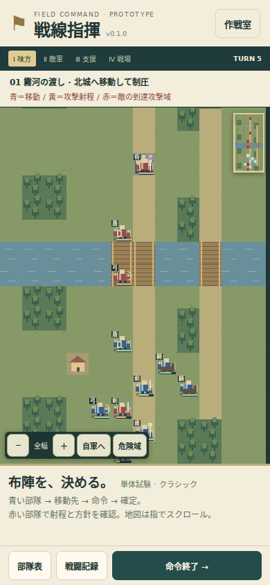
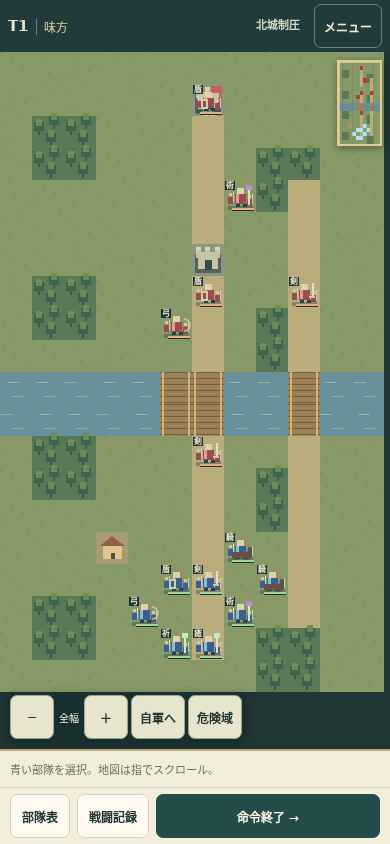
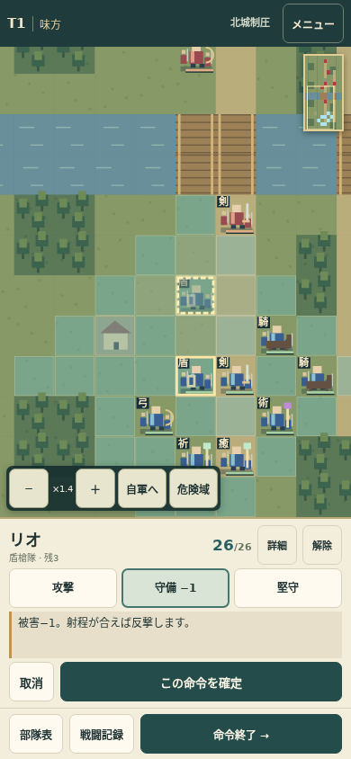

# スマホUI改善 v0.1.1

2026-10-17。戦闘の数値・マップ配置・4フェーズ処理は維持し、表示と入力・保存を改善。

## 見える範囲と操作

プレイ中の上部はターン、現在フェーズ、勝利条件、メニューの1行に統合。タイトル・英語見出し・開発表示・バージョンはメニューへ移動した。現在の警告がない時は予告欄を隠し、砲撃／増援の確報がある場合は上部に残す。勝利条件を押すとマップの説明を開ける。

未選択の命令欄は36px。選択中の部隊と命令は下部の固定高パネルで操作し、主要なタップ領域を44px以上に拡大。能力詳細・被害上限・支援対象・温存設定は「詳細」へまとめ、取消と選択解除は別のボタンにした。同じ部隊の再タップでも解除できる。

| 画面サイズ | v0.1.0の地図高 | v0.1.1の地図高 | 新しい上部 |
|---|---:|---:|---:|
| 390×844 | 514px | 697px | 52px |
| 360×740 | 410px | 593px | 52px |
| 320×568 | 272px | 421px | 52px |
| 844×390 | 206px | 253px | 48px |

地図高は各マップT5・未選択・予告なしの同条件。選択中や砲撃確報時は命令・警告のため地図が狭くなる。390×844で地図高183px（約36%）増。

変更前：

変更後・未選択：

変更後・命令選択：

## 見つけた不具合と対策

- 旧処理はドラッグ後に「次のclickを1回止める」リスナーを登録していた。ブラウザがドラッグのclickを出さない時、次の正しいタップまで失われる。pointerdown/move/up/cancelを一組として判定し、原点へ戻ったドラッグ・実スクロール・複数指・フォーカス喪失はタップにしない方式へ変更。
- ズームやパネル変更のたびに地図の視点がずれる。論理マス座標で視点を維持し、回転後も座標を再計算。
- 勝敗がP2〜P4に確定した保存は、旧版のP1限定ロードで捨てられていた。未完了フェーズは復元せず、終了した戦闘はその結果を復元するよう変更。
- 不正JSON・旧版・未知の兵種／スキル・重複ID・不正ステータスを保存から読んでも画面へ渡さない。保存不可でも新規プレイを継続できる。
- 命令確定・敵フェーズ開始の二度押し、進行中のメニュー／部隊表／記録操作を防止。予期しないフェーズ処理エラー時は開始前のP1へ戻し、入力ロックを必ず解除する。

## 検証

- ルールと入力・保存の単体試験21項目を実行。
- Chromiumの4画面サイズ×3マップでT5までの操作、画面内の確定ボタン、倍率、危険域、保存復帰を確認。
- 詳細な操作試験11ケース：移動仮指定／取消／解除、原点へ戻るドラッグと次のタップ、pointercancel、ズーム視点、二重確定、破陣の攻撃予測・回数、移動後の即時回復、支援の対象・温存指定、二重フェーズ開始と入力ロック、砲撃予告、回転後の移動、勝敗保存、不正JSON復旧を確認（ケース内に複数の検証を含む）。
- 対象のブラウザ試験でJavaScriptエラー0。詳細は `browser-results-0.1.1.json` と `interaction-results-0.1.1.json`。
- iPhone Safari/WebKit・Android実機、ネイティブのピンチ操作は未検証。スクリーンサイズ・タッチイベントの模擬を実機試験とは呼ばない。

再現：通常の `npm run check` に加え、ルートをHTTPサーバーで配信し `node tests/browser-check.mjs` と `node tests/interaction-check.mjs`。

## 公開確認

コード更新 `ff099ca8639091cd6e78e9dbacd7f552f2daa5a3` のルールCIとPagesデプロイが成功。公開版 https://hane-san.github.io/SRPG/?v=0.1.1 を開き、部隊選択・移動先の仮指定・守備の確定・T1からT2への進行を確認。公開画面の記録は `public-ui-0.1.1.jpg`。
