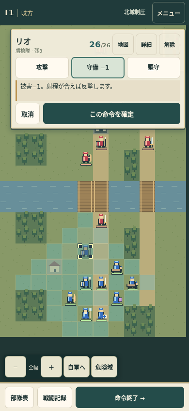
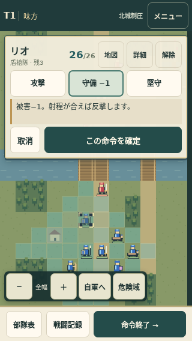
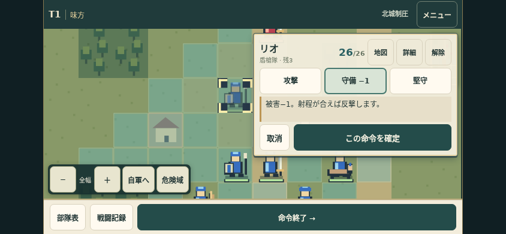

# 地図を動かさないUI v0.1.2

2026-10-17。GBA世代のSRPGの「地図に窓を重ねる」「移動先→命令→確定」を手がかりに、スマホの44pxタップ領域を維持して整理した。戦闘数値・配置・4フェーズ・保存形式は変更していない。FEの絵やコードは使用せず、駒はすべてcanvasの矩形によるオリジナル。

## 修正

旧版は選択時に命令欄が36pxから210pxへ広がり、地図が縮んでいた。論理的な中央を保持しても画面上の駒は動く。命令欄・警告を地図と同じ固定領域上の絶対配置へ変え、refresh時のカメラ調整と選択時のkeepVisibleを廃止した。命令の開閉でviewport/canvasの矩形とscrollLeft/scrollTopは一切変化しない。

選択時は100pxの案内窓と移動範囲。移動先をタップして204pxの命令窓へ展開し、その場なら「命令」で開く。「地図」で仮指定を保ったまま縮め、「取消」で仮指定を元に戻して移動先選択へ。確定前の実移動・HP・消費は発生しない。部隊の再タップ／解除で選択解除。窓は選択時の部隊と反対側に置き、サブメニューで位置を変えない。カメラ移動はスクロール・全体図・自軍へ・部隊表の明示的な注目、ズームと回転時の調整に限定。

1部隊は一体のシルエットにした。所属は青／赤、兵種は盾・剣・弓・馬・本・杖・救護鞄、行動済みは灰色＋点。HPバーと仮移動先の薄い駒、四隅のカーソルを残し、駒上の兵種漢字と小兵2体を廃止。

| 画面 | 固定の地図高（未選択／命令中／予告時） |
|---|---:|
| 390×844 | 733px |
| 360×740 | 629px |
| 320×568 | 457px |
| 844×390 | 283px |

## 確認結果

- `npm run check`：構文とルール・入力・保存21試験、全通過。
- `tests/browser-check.mjs`：4画面×3マップ、T5まで。選択、移動先、命令予測、詳細開閉、メニュー開閉、確定／解除、各フェーズと予告表示で、viewportとcanvasの矩形・スクロール位置を完全一致で比較。全通過。倍率・危険域・保存復帰・画面外はみ出しも確認。
- `tests/interaction-check.mjs`：攻撃予測と破陣の回数、移動後回復、待機支援の対象と温存、ドラッグ誤タップ、取消、二重確定、進行ロック、砲撃予告、回転後の座標、終了状態保存、不正保存の11ケース、全通過。
- `tests/overlay-check.mjs`：4画面で実際のタッチ選択→その場命令→地図へ縮小→再展開→取消→移動先→守備確定を実行。全操作でカメラ不変、各ボタン44px以上・画面内、仮移動後の確定位置を確認。全通過。
- 対象のChromium試験のJavaScriptエラー0。JSONの実測記録を同じdocsに保存。

## 残る課題

重ね窓は地形の一部を隠す。「地図」で縮めるか、プレイヤーがスクロールして確認できる。窓自体のドラッグ移動やカメラ追尾は今回追加していない。指の移動に合わせた経路アニメーション・戦闘アニメーションも未実装で、命令確定後に即時反映する。

iPhone Safari/WebKitとAndroid実機は未検証。今回のスマホ試験はChromiumの画面・タッチ模擬であり、実機性能やOS固有操作の確認ではない。バランスの既存の仮説は docs/balance.md に継続して残している。

## 画面

