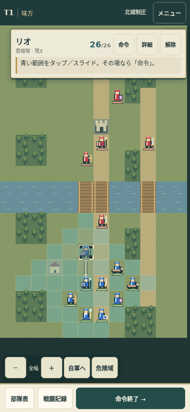
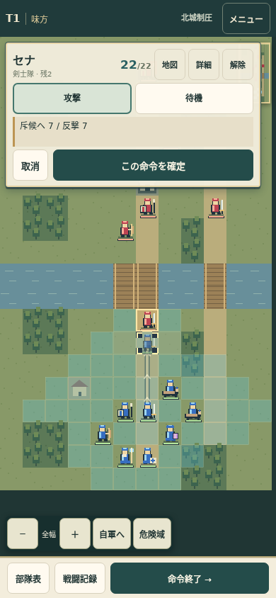

# 攻撃／待機と指操作 v0.2.0

2026-10-17（日本時間）。ユーザー指定に基づき、命令を攻撃／待機だけに絞り、不動待機をP3スキル準備へ統一した。タップ／スライドで移動先、仮移動先から敵へのフリックで攻撃対象を選べる。

## 命令と戦闘

| P1で確定した操作 | P2反撃 | P3 |
|---|---|---|
| 移動＋攻撃／その場で攻撃 | 通常どおり | なし |
| 移動＋待機 | 通常どおり | なし |
| 動かず待機：攻撃スキル残あり | しない | その兵種の射程で自動攻撃 |
| 動かず待機：攻撃スキル残0 | 通常どおり | なし |
| 動かず待機：回復役 | しない | 隣接の味方へ自動回復 |

盾・剣・弓・魔道・騎兵の有限回数は待機攻撃に、祈祷・救護は待機回復に統一した。盾・剣・魔道・騎兵のP3射程は通常射程、弓のみ2〜3。回復は7、枯渇後のH0/H1/H2は維持。HP・攻守・移動・通常射程・初期回数・3マップの配置／イベントは据え置いた。堅守・破陣・疾駆・即時回復と通常守備−1は今回の試作から外した。

未操作のまま命令終了した部隊も、その場待機として準備する。P3はP2の移動・被害後に自動判定し、対象なしは消費0、効果時に1消費。P3攻撃は反撃されない。対象優先・温存は詳細画面に残した。温存時も構えによるP2反撃放棄は継続する。

## 指の操作

部隊を選び、青い範囲をタップまたは指でなぞると、仮の移動先・薄い矢印・カーソルが更新される。矢印は実際の移動判定と同じDijkstraの親経路から描く。森のコスト、敵の通過禁止、味方の通過可／重複停止不可、移動力を共有するため、通れない近道は表示しない。指で描いた迂回線そのものを任意に確定する仕様ではなく、目的地までの最小コスト経路を示す。

移動先を決めた後、仮の駒から敵のマスへ指を滑らせて離すと、敵タップと同じ攻撃対象選択になる。元の仮移動先は維持し、予測を表示する。射程外なら確定できない。フリックだけで移動・ダメージ・消費は起こらず、最後に「この命令を確定」を押す。

青い移動範囲から始めるドラッグはルート編集、範囲外からは地図スクロール。未選択時はブラウザのスクロール。選択中はpointer captureとtouch-actionで操作を分離し、ブラウザのスクロールにルート入力が奪われないようにした。選択中の2本指操作は仮指定を巻き戻して中止し、倍率変更は＋／−で行う。指の中断・フォーカス喪失も操作前の仮指定へ戻す。

命令窓の開閉で地図の領域・スクロール位置は変化しない。自動カメラ追尾や画面端の自動スクロールは追加していない。画面外の移動先は、先に範囲外から地図をスクロールして表示する。

## 実行した検証

- `npm run check`：23試験が通過。4フェーズ、有限回数、全攻撃兵種の不動待機、移動後待機とP1攻撃後のP3禁止、枯渇時の反撃、回復H0/H1/H2、永久離脱、予告、保存、経路コストと占有を確認。
- `tests/interaction-check.mjs`：Chromiumへ実タッチ列を送る11ケースが通過。指を離す前のカーソル／矢印、タップ／スライド、P3攻撃・回復、仮駒→敵のフリック、射程外の拒否、中断・複数指の巻戻し、範囲外パン、二重確定と保存、進行ロック、予告、回転後の座標、終了状態と不正保存の復旧を確認。
- `tests/browser-check.mjs`：390×844、360×740、320×568、844×390の4画面×3マップで各T5まで実行。地図の矩形とスクロール位置は、選択・命令・詳細・メニュー・確定・予告表示を通じて完全一致。ズーム・危険域・ログ・再読込も確認。
- `tests/overlay-check.mjs`：上記4画面＋1363×936の5画面で、命令開閉・取消・スライド移動・敵へのフリック・明示確定を確認。全画面で地図不変、主要ボタン44px以上、画面内。フリックで予測だけを出し、確定後に敵HPが22→15になることも確認。
- 対象のブラウザ試験でJavaScriptエラー0。結果JSONは同じdocsに保存。

iPhone Safari/WebKit・Android実機の操作やFPSは未検証。Chromiumの画面／タッチ模擬を実機検証とは呼ばない。

## バランスの観測

`node tests/simulate.mjs --save` で、攻撃／待機だけを選ぶ同じ貪欲方策を実行した。最適解の探索でも、人間の攻略難度の証明でもない。旧版の方策も行動メニューが違うため、純粋な数値比較とはしない。

| マップ | 通常前進 | 慎重前進 | 初期位置で全待機 |
|---|---|---|---|
| 第1 | T18勝利・5隊生存 | T15勝利・7隊生存 | T36打切り・7隊生存 |
| 第2 | T2敗北・7隊生存 | T6敗北・5隊生存 | T3敗北・7隊生存 |
| 第3 | T36打切り・2隊生存 | T36打切り・1隊生存 | T12全滅 |

1. 不動待機で全前衛がP2反撃を放棄するため、停止すると安全とは限らない。移動して通常反撃を使うか、停止してP3を待つかの違いが強く出る。一方、反撃のためだけの1マス移動を誘発する可能性は人間のテストで見る。
2. 第2の本陣防衛と第3の進軍・回復は簡易方策で厳しい。旧アクティブスキルの削除、P2反撃機会、即時回復の消失が同時に効いている。今回、配置や敵数を勝手に調整せず、操作を試すための版として記録する。次は防衛位置・敵の到着ターン・回復役の配置から検討する。
3. 祈祷隊と救護隊は現時点で同じ数値・同じ待機回復になった。役割を分けるより、片方を編成から減らす案も含め、命令を増やさずに整理する余地がある。
4. 第1の全待機は多数生存しても城を取れず、停滞は残る。H1や有限回数だけで前進を促せるとは結論づけない。

以前の検討・仮説は balance.md、今回の生データは simulation-results-0.2.0.json。旧試験記録は上書きしていない。

## 画面

