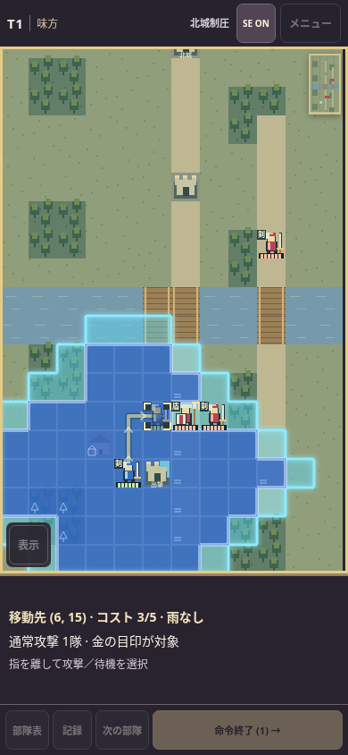
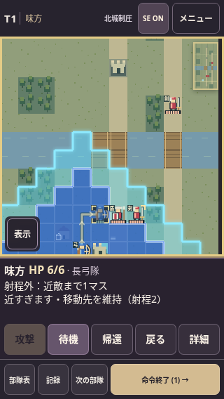

# Issue #22 — 最新版からの位置取り表示の追加

基準は `528a9c5`（PR #18 のHP6配置・入力・SE、PR #16 の現在参照、PR #9 の42曲化を含む）。[Issue #22](https://github.com/hane-san/SRPG-01-FEstyle/issues/22) の実装候補。旧作業の差分を再適用せず、現在のルールを読み取りやすくする追加として作成した。統合前の採否と独立監査はPRで判断する。

## 追加したこと

- **位置取りの判断**：経路編集中の固定ドックに、1始まりの移動先座標・地形込みの移動コスト/当ターンの移動力・天候を表示。森1マスは2消費、雨は `engine.movement` の歩兵/騎兵の減少をそのまま使用する。残り移動で再行動できる意味ではない。
- **通常攻撃の対象**：その移動先から攻撃できる敵の上角に金の印を描く。青い移動範囲・外側の水色範囲は従来どおり。金の印はP1の通常射程であり、P3の発動や反撃されないことを保証しない。
- **射程外の説明**：敵の名前、選んだ位置からのマンハッタン距離、最小/最大射程を表示。弓の隣接は「近すぎます」。明示経路がある場合は全座標を保持し、別の合法な敵へ差し替えない。経路未指定で届く接近先がない敵も「移動しても届きません」と返す。
- **城からのドラッグ**：出撃準備中の城起点を「移動先の押下」と誤分類していたため、部隊起点の経路編集として扱う。空城/味方で埋まった城の両方で、ドラッグ→予測のみ→待機一押しで出撃できる。取消は出撃枠を使わない。
- **砲撃の盤面ラベル**：上部の予告とログは修正済みだったが、Canvas内だけ `P4 −6` が残っていた。ここも `RULES.barrageDamage` を使い、現在の実ダメージ `−2` と一致させた。

## 変更境界と実装

`app.js` / `ui-model.js` / `render.js` / `style.css` と読込みタグ、検証だけを変更。敵配置・全地形・AI・戦闘数値・フェーズ・保存形式・既存SE・42曲の楽譜と割当は基準mainのまま。版番号は0.8.0を保持し、変更した表示モジュールとCSSのURLだけ更新する。

経路は `engine.routeTo` の経路を読み、入力更新時に地形コストを合計する。表示のために到達探索を増やさず、アニメーションフレームでは経路情報を組み立てない。攻撃対象は既存の `attackTargets` / `engine.inRange` と共通。金の印は既存の戦術背景キャッシュへ描き、追加のマップ大Canvasや常時アニメーションは持たない。

144pxの固定ドック、44px操作、予測→攻撃/待機一押し、未操作部隊がいるときのターン終了確認は維持する。PR #20（Claude監督・メニューリンク）とIssue #21（横持ちの盤面面積）は別件として取り込んでいない。

## 検証したこと

- Node 24.19.0、`npm run check`：62件成功（既存59件＋経路/雨/射程理由の3件）。到達不能な敵への選択の旧「無反応」の期待値は、理由付きのプレビューへ変更した。
- Playwright 1.57.0 / ローカルChromium 154、`npm run test:browser`：既存HP6・42曲サウンドルームと波形・公開パス移行・Issue #17回帰に、`position-preview-browser.mjs` を追加。
- 追加ブラウザ検証：320/360/390/844px × 6マップの24条件で、座標・コスト・移動力・大雨・14px表示とドック内収まりを検査。指保持中は命令欄を隠し、プレビュー/取消で戦闘状態とカメラを変えない。
- 森1マスでコスト2、経路保持と射程外理由、隣接弓の拒否と他対象への差替え防止、届かない直接選択、攻撃一押しと再読込を確認。城が空/味方占有の両条件で、出撃ドラッグ→取消→出撃一押し→再読込を同じエンジン結果と照合。
- Canvasの実ピクセルで、弓の隣接敵には金印がなく、距離2の敵だけに付き、死亡後は消えることを検査。30回の同一描画で全キャッシュの再生成0回。Canvasに渡す文字も `P4 −2` であることを確認。
- Issue #17の同じ24条件（調整前/後の配置×前進/待機×6マップ）を再実行し、勝敗・ターン・生存・予備・命令数・離脱がmain保存済みの結果と全件一致。調整後の前進例は01〜06順にT11/T14/T11/T17/T30/T34で勝利。面白さ・最適戦略・一般兵のみの完走の証明ではない。
- `git diff --check` 成功。実行した対象SHAとGitHub CIの結果はPR本文を正本とする。

スクリーンショットは固定試験盤面のChromium模擬。iPhone Safari/Android実機の操作感・聴感・背景復帰は今回検証していない。

## Claudeの後続監査へ

medium（入力分類と戦術表示）。実装者のチェックを独立監査とは扱わない。ユーザーが予定しているClaudeの別セッション監査へ渡すため、PRを開いた状態にし、mainへのマージや自動マージは行わない。

1. PRのhead SHAと現在mainを再取得し、PR #18/#16/#9を巻き戻していないこと、PR #20/#21との境界を確認する。
2. 上記コマンドを再実行。出撃元の城と、新しく押した移動先の分類が混ざらないことを重点確認する。
3. 大雨の歩兵/騎兵、森のコスト、射程2の隣接不可、移動先固定、届く別の敵がいても射程外対象を差し替えないことを確認する。
4. 金の印が読みやすいか、情報が多すぎないかは実機で評価する。固定ドックの寸法緩和・バランス数値変更はこのPRへ混ぜない。
5. 独立監査の担当セッション・対象SHA・再現条件・実行/未検証・PASS/WARN/BLOCKと人間試遊項目をPRへ記録する。CI成功を監査や採用の代わりにしない。
